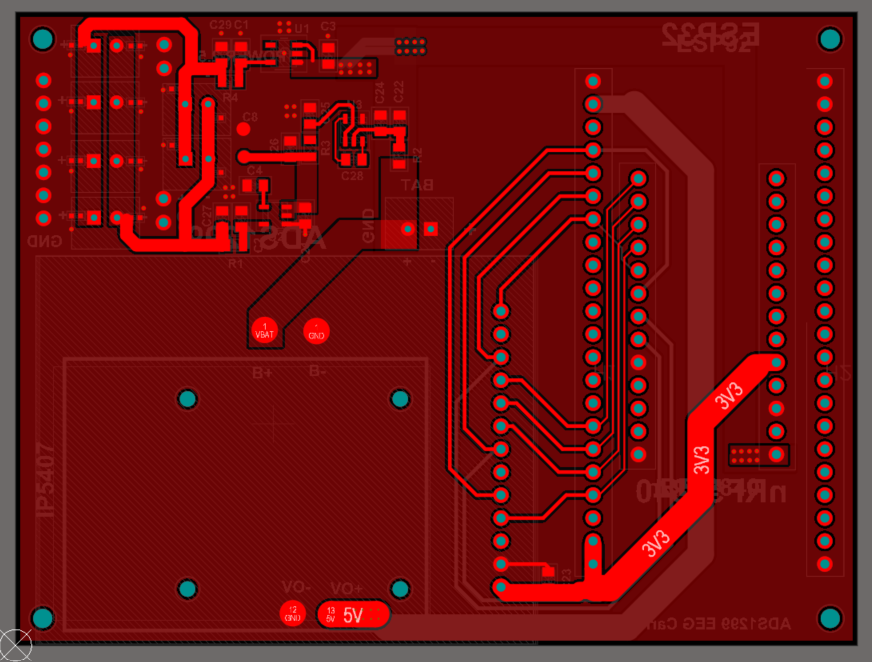
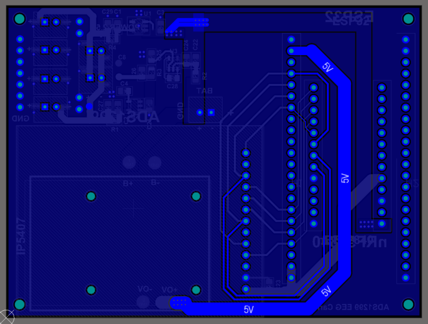
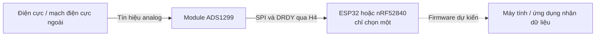
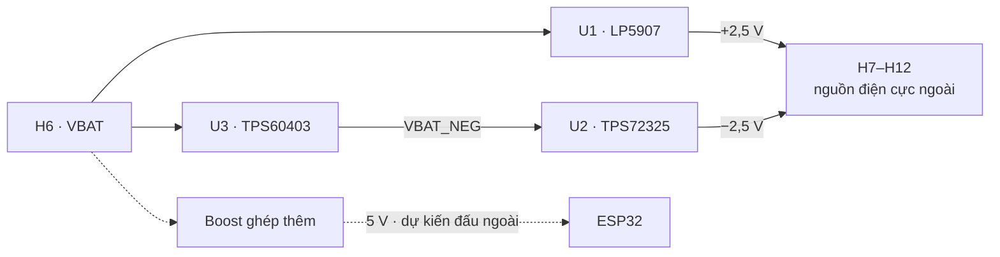

# ADS1299 EEG Carrier V2.0

_Board kết nối và cấp nguồn cho hệ thu nhận tín hiệu EEG — thiết kế bằng Altium Designer._

Tôi phát triển board này để ghép **module ADS1299**, **ESP32 hoặc nRF52840** và khối nguồn điện cực thành một cụm phần cứng phục vụ nghiên cứu EEG, hướng tới lắp trên băng đô đeo đầu. Board carrier tập trung các kết nối và đường nguồn; module ADS1299 đảm nhiệm số hóa tín hiệu, còn bộ xử lý được chọn sẽ điều khiển và đọc dữ liệu qua SPI.[^ads1299]

*Top Layer — ảnh layout PCB do tác giả chuẩn bị trong thư mục IMAGE.*

*Bottom Layer — ảnh layout PCB do tác giả chuẩn bị ngày 26/10/2026. [Xem bộ ảnh và schematic tham khảo](hardware/v2.0/docs/images/user-2026-10-26/README.md).*

## 🎯 Dự án này giải quyết việc gì?

Một hệ EEG cần phối hợp điện cực, mạch thu nhận analog, bộ xử lý và nguồn cấp. Mục tiêu của thiết kế là gom phần kết nối và phân phối nguồn lên một PCB, để thử hai lựa chọn bộ xử lý trên cùng nền tảng ADS1299, thay cho việc nối từng nhóm dây giữa các module.

Phạm vi của repository gồm schematic, layout PCB, thư viện, BOM và tài liệu ghép nối. Thiết kế phần cứng là trọng tâm hiện tại; phần firmware truyền dữ liệu và kết quả đo EEG sẽ được bổ sung khi có thực nghiệm. Chỉ cắm **một trong hai** bộ xử lý ESP32 hoặc nRF52840 tại một thời điểm.

## 🔄 Tín hiệu đi qua hệ thống như thế nào?

Đường analog từ điện cực tới module ADS1299 thuộc phần ghép ngoài. Trên carrier, H4 đưa ra các tín hiệu SPI và điều khiển. **H7–H12 là giắc nguồn ±2,5 V cho điện cực ngoài**, không phải sáu cổng tín hiệu EEG. Số giắc nguồn không quyết định số kênh ADC.

## 🧩 Những linh kiện và module nào có trên board?

| Khối | Vị trí / linh kiện | Vai trò trong thiết kế |
| --- | --- | --- |
| Thu nhận EEG | **H4 — module ADS1299 cắm thêm** | ADC và giao tiếp số nằm trên module; ADS1299 là dòng ADC 24 bit cho tín hiệu điện sinh học.[^ads1299] |
| Bộ xử lý tùy chọn A | **H1/H2 — kit ESP32-S3** | Điều khiển module và đọc SPI; có thể phát triển đường truyền Wi-Fi/Bluetooth LE bằng firmware.[^esp32] |
| Bộ xử lý tùy chọn B | **H3/H5 — module nRF52840** | Lựa chọn bộ xử lý cho cấu hình Bluetooth LE; dùng thay cho ESP32.[^nrf52840] |
| Nguồn dương | **U1 — LP5907MFX-2.5/NOPB** | LDO tạo nhánh +2,5 V từ VBAT theo sơ đồ nguồn.[^lp5907] |
| Đảo nguồn | **U3 — TPS60403DBVR** | Charge pump tạo nguồn âm thô VBAT_NEG.[^tps60403] |
| Nguồn âm | **U2 — TPS72325DBVR** | LDO âm tạo nhánh −2,5 V từ VBAT_NEG.[^tps723] |
| Pin và điện cực ngoài | **H6; H7–H12** | H6 nhận GND/VBAT; sáu giắc H7–H12 đưa ra +2,5 V và −2,5 V |
| Lọc và ghép nguồn | **25 tụ C; R1–R4 = 0 Ω** | Các tụ thuộc khối nguồn/decoupling; điện trở 0 Ω nối các đoạn nguồn, thuận tiện tách nhánh khi kiểm tra |
| Điểm đo | **TP1–TP5** | Truy cập VBAT, −2V5, +2V5, VBAT_NEG và GND |
| Cấp nguồn cho ESP32 | **Module boost cắm/ghép thêm** | Cấu hình dự kiến VBAT → 5 V; mô hình cơ khí đã có trên PCB, phần đấu dây cần hoàn thiện theo hệ thống |

Ba IC U1–U3 là linh kiện hàn trên carrier. ADS1299, ESP32, nRF52840 và boost là các module ghép thêm; hình 3D của module không tự tạo kết nối điện trên schematic.

→ [Xem giải thích từng nhóm linh kiện, đường nguồn và điểm đo](hardware/v2.0/docs/BOARD_OVERVIEW.md).

## ⚡ Khối nguồn hoạt động ra sao?

## 📚 Bắt đầu xem thiết kế

| Bạn muốn tìm hiểu | Tài liệu |
| --- | --- |
| Board có những khối nào, linh kiện làm gì? | [Giới thiệu phần cứng](hardware/v2.0/docs/BOARD_OVERVIEW.md) |
| Chân nào nối tới net nào? | [Pinout từ PCB](hardware/v2.0/docs/PINOUT.md) |
| Danh sách linh kiện và footprint? | [BOM](hardware/v2.0/docs/BOM.md) · [CSV](hardware/v2.0/docs/BOM.csv) |
| Mở và chỉnh sửa bằng Altium? | [Hướng dẫn V2](hardware/v2.0/README.md) · [Project](hardware/v2.0/altium/BOARD_ADS%20_V2.0%20(1).PrjPcb) |
| Đã kiểm tra tới đâu? | [Trạng thái kiểm tra](hardware/v2.0/docs/VALIDATION.md) |
| Dữ liệu đặt mạch? | [Ghi chú Gerber hiện có](hardware/v2.0/manufacturing/README.md) |
| V1 khác V2 ra sao? | [CHANGELOG](CHANGELOG.md) · [README V1](docs/README_V1.md) |

## 🧪 Trạng thái phát triển

Nguồn V2 đã được đưa lên repository; hai ảnh layout trong README được tác giả cung cấp từ thư mục IMAGE ngày **26/10/2026**. Bộ nguồn Altium trong repository vẫn là snapshot đã đóng gói ngày 25/10; lần cập nhật này bổ sung ảnh và tài liệu. Chưa công bố kết quả lắp ráp, đo nguồn, giao tiếp hoặc thu tín hiệu EEG thực tế. Khả năng của IC/module trong datasheet không phải là kết quả đo của toàn hệ thống.

Gerber hiện có từ 22/10, trước lần lưu PCB ngày 25/10; cần xuất lại hoặc đối chiếu trước khi dùng đặt mạch. [Chi tiết các mục cần chốt](hardware/v2.0/docs/VALIDATION.md).

[^ads1299]: Texas Instruments, [ADS1299-x datasheet](https://www.ti.com/lit/ds/symlink/ads1299.pdf), tr. 1 và mục 9: ADC cho EEG/biopotential, giao tiếp SPI. Số kênh cụ thể phụ thuộc biến thể IC/module được lắp.
[^esp32]: Espressif, [ESP32-S3 overview](https://www.espressif.com/en/products/socs/esp32-s3): khả năng Wi-Fi/Bluetooth LE của SoC; pinout và nguồn cấp của kit thực tế cần được đối chiếu riêng.
[^nrf52840]: Nordic Semiconductor, [nRF52840 overview](https://www.nordicsemi.com/Products/nRF52840): Bluetooth LE và SPI của SoC; không thay thế bản vẽ module được cắm.
[^lp5907]: Texas Instruments, [LP5907 datasheet](https://www.ti.com/lit/ds/symlink/lp5907.pdf), tr. 1 và mục 6: LDO; mức 2,5 V theo mã linh kiện và rail trên schematic dự án.
[^tps60403]: Texas Instruments, [TPS6040x datasheet](https://www.ti.com/lit/ds/symlink/tps60403.pdf), tr. 1 và mục 8: charge pump tạo điện áp âm chưa ổn áp.
[^tps723]: Texas Instruments, [TPS723 datasheet](https://www.ti.com/lit/ds/symlink/tps723.pdf), tr. 1 và mục 6: LDO âm; nhánh −2,5 V theo mã TPS72325 và schematic dự án.
