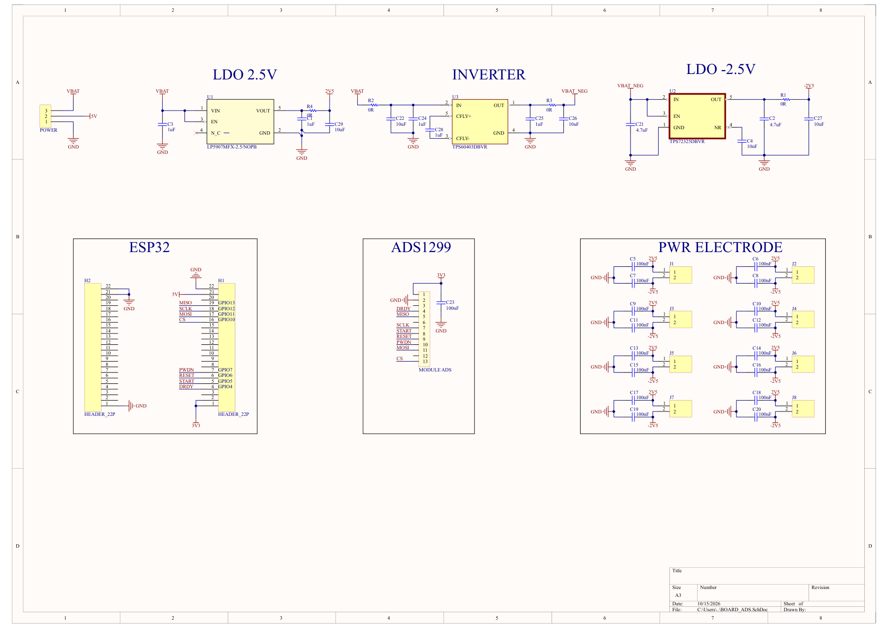

# Board kết nối ESP32 và module ADS1299, tích hợp khối nguồn

Board giao tiếp giữa kit ESP32 và module ADS1299, kèm khối nguồn dương/âm và các connector phân phối nguồn. Project tập trung vào thiết kế board kết nối và nguồn; kit ESP32 và module ADS1299 là các phần ghép ngoài.

**Trạng thái: bản thiết kế prototype.** Gói được chuẩn bị ngày 15/10/2026. Chưa có kết quả đo phần cứng, firmware hoặc báo cáo ERC/DRC mới được thực hiện trong lần đóng gói này.



Ảnh xem nhanh được dựng từ PDF nguồn có sẵn. PDF nguồn được xuất lúc 08:54 ngày 15/10/2026, trước lần lưu schematic lúc 17:53 cùng ngày. Chưa xác nhận PDF khớp hoàn toàn schematic hiện tại. Khi có khác biệt, dùng file Altium làm nguồn để kiểm tra và xuất lại PDF.

## Thông tin chính

| Hạng mục | Thông tin |
| --- | --- |
| Project Altium | BOARD_ADS |
| Linh kiện trên schematic / PCB chính | 48 / 48 |
| Các khối chính | H1/H2 cho kit ESP32; H4 cho module ADS1299; U1 LP5907MFX-2.5/NOPB, U3 TPS60403DBVR và U2 TPS72325DBVR cho khối nguồn. |
| Công cụ thiết kế | Altium Designer; phiên bản tạo file chưa được ghi nhận |
| Danh sách linh kiện | Bản tham khảo từ schematic, chưa chốt mua hàng |

## Nội dung thư mục

```text
.
├── README.md
├── .gitignore
├── .gitattributes
├── hardware/
│   ├── altium/             # Project, schematic, PCB và thư viện nguồn
│   ├── schematic/          # PDF nguồn có sẵn
│   └── bom/BOM.md          # Danh sách linh kiện tham khảo
├── docs/
│   ├── HARDWARE.md         # Mô tả khối và bảng chân
│   ├── VALIDATION.md       # Các phép kiểm tra cần thực hiện
│   ├── PACKAGE_NOTES.md    # Phạm vi đóng gói và điểm còn mở
│   └── package-manifest.json
└── images/
    └── schematic-preview.png
```

## Mở thiết kế

1. Tải về hoặc clone toàn bộ repo.
2. Mở [BOARD_ADS.PrjPcb](../hardware/altium/BOARD_ADS.PrjPcb) bằng Altium Designer.
3. Giữ các file trong `hardware/altium/` cùng nhau; thêm thư viện đi kèm vào thư viện khả dụng nếu Altium yêu cầu.
4. Chạy compile, kiểm tra tham chiếu symbol/footprint và kết nối schematic–PCB trước khi thực hiện ECO hoặc xuất dữ liệu sản xuất.

Project nguồn có thêm `PCB1.PcbDoc`, đọc được 0 linh kiện. File này được giữ nguyên để bảo toàn cấu trúc project, nhưng không dùng làm PCB chính. PCB chính là `BOARD_ADS.PcbDoc`.

Nội dung schematic, PCB và thư viện được giữ nguyên. Bản sao `.PrjPcb` được dọn tham chiếu báo cáo sinh tự động và chuyển đường dẫn tài liệu sang tương đối để thuận tiện chia sẻ. Tham chiếu thư viện lịch sử bên trong file thiết kế vẫn cần được kiểm tra khi dùng Update From Libraries.

## Tài liệu đi kèm

- [Schematic PDF](../hardware/schematic/BOARD_ADS_Schematic.pdf).
- [Mô tả phần cứng và bảng chân](../docs/HARDWARE.md).
- [Danh sách linh kiện tham khảo](../hardware/bom/BOM.md).
- [Kế hoạch kiểm tra](../docs/VALIDATION.md).
- [Ghi chú đóng gói](../docs/PACKAGE_NOTES.md).
- [Danh sách file và mã SHA-256](../docs/package-manifest.json).

## Các mục còn mở

Thư viện hiện có chưa chứa footprint `XH2.54M-3` của H3. C1–C29 khai báo Case/Package = 0402 trong khi model là C0805L. Đây là các mục cần hoàn tất trước khi cập nhật từ thư viện hoặc lập BOM mua hàng.

Cần bổ sung ảnh PCB/board thật, thông tin linh kiện mua hàng, kết quả đo và báo cáo ERC/DRC đúng phiên bản. Các báo cáo cũ, cache, History và dữ liệu xuất chưa được xác nhận không nằm trong gói này. Chưa có Gerber/CPL được chốt để chế tạo.

## Đưa lên GitHub

Đưa **nội dung bên trong thư mục này** vào thư mục gốc của một repo riêng. README và tài liệu dùng tiếng Việt, giữ các thuật ngữ chuyên ngành bằng tiếng Anh. `.gitattributes` giữ nguyên byte của file Altium khi lưu bằng Git.
