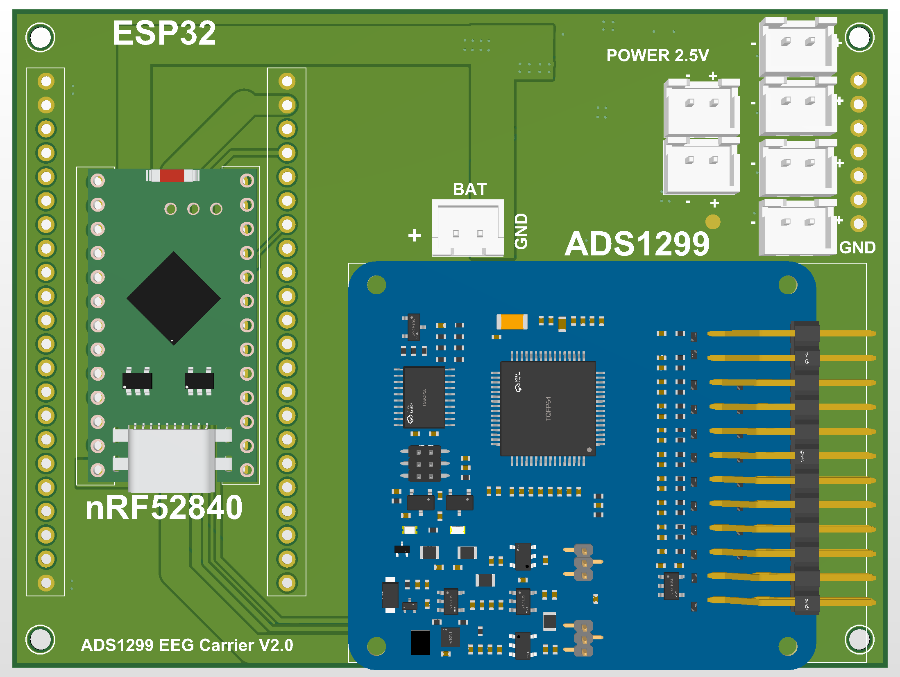
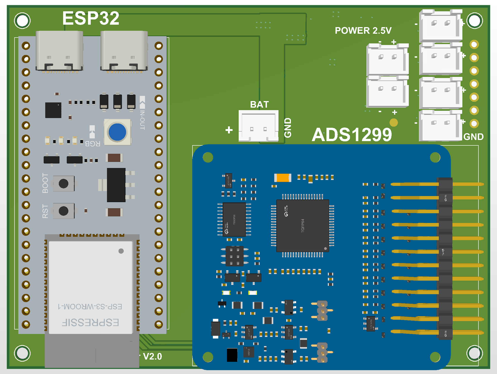
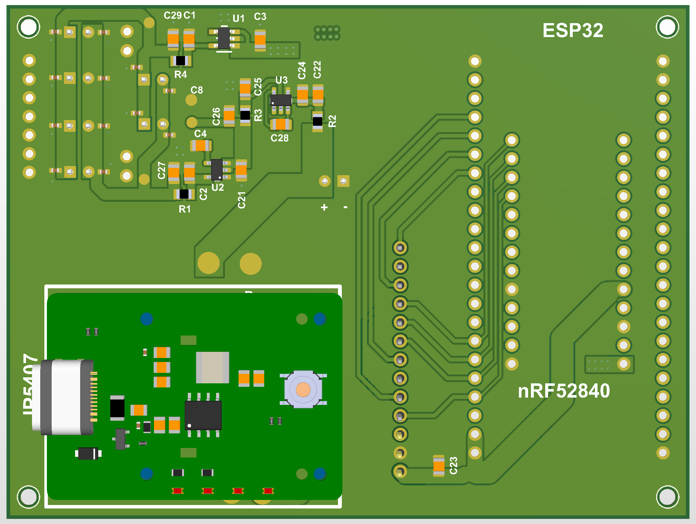

# Tìm hiểu board ADS1299 EEG Carrier V2.0

_Giới thiệu cấu trúc phần cứng, vai trò linh kiện và cách đọc bản thiết kế — cập nhật ảnh 26/10/2026._

---

## 🎯 Vai trò của carrier trong hệ EEG

Carrier là board nền để kết nối các module có sẵn và phân phối nguồn. Trong dự án này, module ADS1299 tiếp nhận tín hiệu analog từ điện cực ngoài và cung cấp dữ liệu số. Một kit ESP32 hoặc module nRF52840 được chọn để điều khiển, đọc và xử lý dữ liệu; carrier nối các đường SPI và điều khiển giữa chúng.[^adc]

Mục tiêu tiếp theo là tích hợp cụm phần cứng vào băng đô đeo đầu và phát triển phần mềm nhận dữ liệu. Các đường truyền, tốc độ lấy mẫu, số kênh hoạt động và chất lượng tín hiệu sẽ được mô tả bằng cấu hình firmware và kết quả đo khi có.

| Top — cấu hình nRF52840 | Top — cấu hình ESP32 |
| --- | --- |
|  |  |

*Hai ảnh mô tả hai cấu hình thay thế nhau: chỉ cắm nRF52840 hoặc ESP32 tại một thời điểm. Đây là ảnh dựng 3D do tác giả chuẩn bị, không phải ảnh board đã lắp ráp.*

## 🧩 Các module cắm thêm

| Vị trí | Module | Nhiệm vụ | Điều cần phân biệt |
| --- | --- | --- | --- |
| H4 | Module ADS1299 | Thu nhận và số hóa tín hiệu điện sinh học, trao đổi dữ liệu qua SPI[^adc] | IC ADS1299 nằm trên module; carrier không triển khai IC này trực tiếp |
| H1/H2 | Kit ESP32-S3 | Cấu hình ADS1299, đọc SPI; có thể phát triển firmware truyền Wi-Fi/Bluetooth LE[^esp] | Vùng có hai hàng 22 chân; đối chiếu đúng kit, chiều chân và khoảng cách hàng |
| H3/H5 | Module nRF52840 | Lựa chọn bộ xử lý thay ESP32; có thể phát triển firmware truyền Bluetooth LE[^nrf] | Hai hàng 13 chân trên carrier; không mặc định tương thích mọi board nRF52840 |
| Mô hình boost trên PCB | Module nguồn ghép thêm | Cấu hình dự định VBAT → 5 V cho ESP32 | Mô hình 3D chỉ mô tả cơ khí; không có IC boost được triển khai trong schematic carrier |

**Chỉ cắm ESP32 hoặc nRF52840 tại một thời điểm.** Hai lựa chọn sử dụng các net giao tiếp chung. Repo chưa kèm firmware thu/truyền EEG đã được kiểm thử.

## ⚡ Ba IC nguồn trên carrier

| IC | Loại mạch | Vai trò theo kết nối schematic |
| --- | --- | --- |
| U1 — LP5907MFX-2.5/NOPB | LDO dương[^positive] | VIN nhận VBAT; đầu ra qua R4 tới rail 2V5 |
| U3 — TPS60403DBVR | Charge pump đảo nguồn[^inverter] | Nhận VBAT qua R2; đầu ra qua R3 tạo rail VBAT_NEG |
| U2 — TPS72325DBVR | LDO âm[^negative] | Nhận VBAT_NEG; đầu ra qua R1 tới rail −2V5 |

LDO tạo rail ổn áp từ một rail đầu vào phù hợp; charge pump tạo điện áp âm để U2 có đầu vào âm. Đây là vai trò của các khối trong thiết kế, chưa chứng minh mức ripple, dòng tải hoặc nhiệt độ của board đã lắp. Đặc biệt, giới hạn riêng của U2 không thể dùng làm dòng định mức của cả nhánh U3 → U2.

Khối ±2,5 V phục vụ mạch điện cực ngoài theo cấu hình dự án. Không mặc định hai rail này đã cấp đầy đủ nguồn analog cho mọi module ADS1299; phải đối chiếu sơ đồ của module được dùng.

## 🔧 Tụ điện và điện trở làm gì?

| Nhóm linh kiện | Giá trị theo schematic | Vị trí trong mạch / vai trò |
| --- | --- | --- |
| C3; C1; C29 | 1 µF; 1 µF; 10 µF | Các tụ nối từ rail vào/ra nhánh U1 xuống GND |
| C22/C24 | 10 µF / 1 µF | Tụ tại đầu vào U3 sau R2 |
| C28 | 1 µF | Tụ bay nối hai chân CFLY của U3; tham gia quá trình đảo nguồn[^inverter] |
| C25; C21/C26 | 1 µF; 4,7 µF / 10 µF | Tụ đầu ra U3 và trên rail VBAT_NEG |
| C4 | 10 nF | Tụ nối chân NR của U2 xuống GND; chức năng giảm nhiễu theo datasheet[^negative] |
| C2; C27 | 4,7 µF; 10 µF | Tụ ở nhánh đầu ra U2/−2V5 |
| C5–C16 | 100 nF | Các tụ nối rail 2V5 hoặc −2V5 xuống GND để hỗ trợ decoupling ở phần phân phối nguồn |
| C23 | 100 nF | Tụ nối rail 3V3 xuống GND |
| R1–R4 | 0 Ω | Các cầu nối trên đường nguồn: R1 ra −2V5, R2 vào U3, R3 ra VBAT_NEG, R4 ra +2V5 |

Giá trị trong bảng là dữ liệu của schematic. Chọn điện áp định mức, dung sai, package và kiểm tra tổng điện dung theo datasheet trước khi lập BOM mua hàng; bảng mô tả chức năng không phải xác nhận mọi giá trị đã tối ưu.

## 🔌 Giắc cắm và điểm đo

| Vị trí | Kết nối theo pad/net PCB | Dùng để |
| --- | --- | --- |
| H6 | Pad 1 = GND; pad 2 = VBAT | Đưa nguồn pin vào carrier |
| H7–H12 | Pad 1 = 2V5; pad 2 = −2V5 | Cấp hai rail nguồn cho mạch điện cực ngoài |
| H4 | 3V3, GND, SPI và các net điều khiển | Ghép module ADS1299 với bộ xử lý |
| TP1 | VBAT | Đo nguồn vào |
| TP2 | −2V5 | Đo rail âm sau ổn áp |
| TP3 | 2V5 | Đo rail dương sau ổn áp |
| TP4 | VBAT_NEG | Đo nguồn âm thô |
| TP5 | GND | Điểm tham chiếu đo điện áp |

H7–H12 chỉ có hai rail nguồn, **không có chân GND riêng**. Nếu mạch điện cực cần GND và tín hiệu analog, các kết nối đó phải được bố trí trong phần ghép ngoài; không coi giắc hai chân này là toàn bộ dây nối điện cực. Xem [pinout đầy đủ](PINOUT.md) trước khi đấu dây; số pad cần được xác định đúng chiều nhìn.

Các net giao tiếp chính là SCLK, MOSI, MISO, CS và DRDY; START, RESET, PWDN là các đường điều khiển được đưa ra trên schematic. Chức năng chi tiết và trình tự giao tiếp lấy theo datasheet ADS1299 và firmware.[^adc]

## 📚 Xem tiếp theo mục đích của bạn

- Muốn chỉnh sửa: mở [project Altium V2](../altium/BOARD_ADS%20_V2.0%20(1).PrjPcb).
- Muốn mua linh kiện: xem [BOM](BOM.md) và đối chiếu các trường còn thiếu.
- Muốn đấu nối: xem [pinout](PINOUT.md), rồi kiểm tra model module thực tế.
- Muốn chế tạo: xem [trạng thái kiểm tra](VALIDATION.md) và [ghi chú Gerber](../manufacturing/README.md).
- Muốn biết ảnh được tạo từ bản nào: xem [bộ ảnh do tác giả cung cấp](images/user-2026-10-26/README.md).

Bộ ảnh 3D trong tài liệu do tác giả cung cấp từ IMAGE/3D ngày 26/10/2026; dữ liệu linh kiện/pinout lấy từ bộ nguồn V2 đã đóng gói ngày 25/10. Chưa có số đo phần cứng hoặc kết quả EEG được công bố ở phiên bản tài liệu này.

[^adc]: Texas Instruments, [ADS1299-x datasheet](https://www.ti.com/lit/ds/symlink/ads1299.pdf), tr. 1, mục 6 và 9: ADC cho EEG/biopotential, chân giao tiếp và hoạt động số. Thông số của IC không thay thế sơ đồ module.
[^esp]: Espressif, [ESP32-S3 overview](https://www.espressif.com/en/products/socs/esp32-s3): Wi-Fi và Bluetooth LE của SoC.
[^nrf]: Nordic Semiconductor, [nRF52840 overview](https://www.nordicsemi.com/Products/nRF52840): Bluetooth LE và SPI của SoC.
[^positive]: Texas Instruments, [LP5907 datasheet](https://www.ti.com/lit/ds/symlink/lp5907.pdf), tr. 1 và mục 6: LDO dương.
[^inverter]: Texas Instruments, [TPS6040x datasheet](https://www.ti.com/lit/ds/symlink/tps60403.pdf), tr. 1, mục 6 và 8: charge pump đảo nguồn và chân CFLY.
[^negative]: Texas Instruments, [TPS723 datasheet](https://www.ti.com/lit/ds/symlink/tps723.pdf), tr. 1, mục 4 và 6: LDO âm và chân NR.
