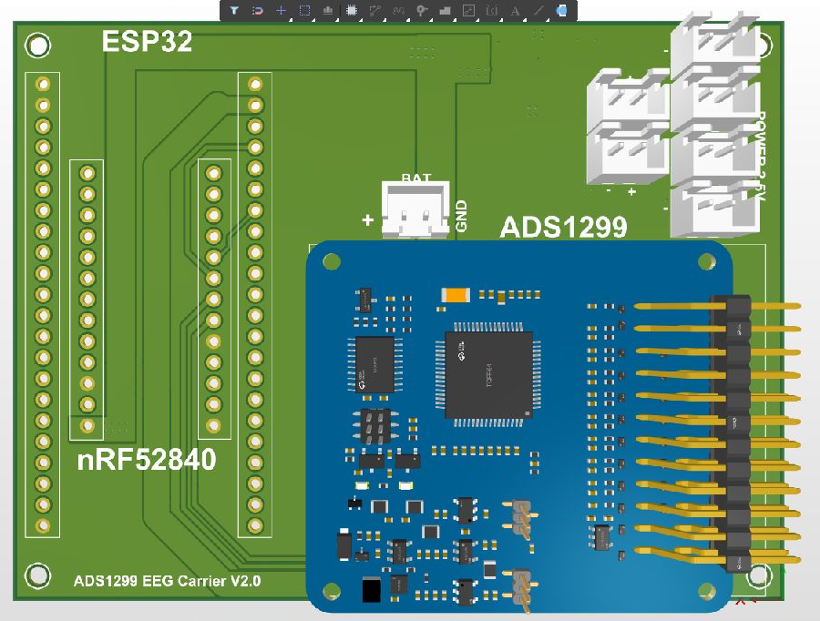

# Tài liệu BOARD_ADS V2.0

_Bắt đầu với hình ảnh và giới thiệu phần cứng, sau đó xem dữ liệu chi tiết._

## 🧩 Hiểu board trước khi mở Altium

- [Giới thiệu các khối và linh kiện](BOARD_OVERVIEW.md).
- [Ảnh 3D bản hiện tại ngày 25/10](images/current-2026-10-25/README.md).
- [Pinout từ PCB](PINOUT.md).
- [BOM tham khảo](BOM.md) · [CSV](BOM.csv).

## 📋 Kiểm tra và truy vết phiên bản

- [Trạng thái kiểm tra](VALIDATION.md).
- [Ghi chú đóng gói và thư viện](PACKAGE_NOTES.md).
- [Snapshot dữ liệu nguồn](design-snapshot.json).
- [Manifest và SHA-256 nguồn](package-manifest.json).
- [Kiểm kê ZIP Gerber cũ](output-inventory.json).

## 🗂️ Tài liệu lịch sử

[PDF nguyên lý ngày 19/10](archive-2026-10-19/BOARD_ADS_V2.0_Schematic_2026-10-19.pdf) và các ảnh ngày 19–22/10 trong `images/` là tài liệu lịch sử. Chúng không được dùng để khẳng định bản nguồn ngày 25/10 đã đạt ERC/DRC hoặc khớp Gerber.
