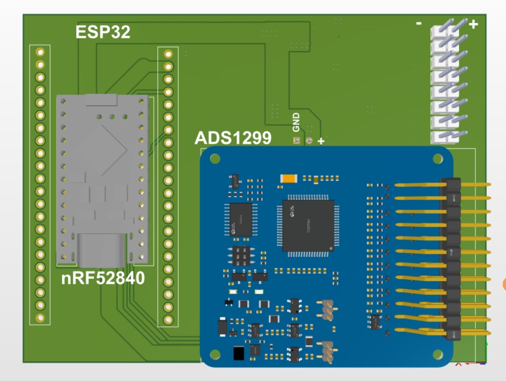

# Tài liệu V2.0

- [BOM tham khảo](BOM.md) và [CSV](BOM.csv).
- [Pinout từ pad/net PCB](PINOUT.md).
- [Trạng thái kiểm tra](VALIDATION.md).
- [Ghi chú đóng gói và thư viện](PACKAGE_NOTES.md).
- [Dữ liệu snapshot đã lưu](design-snapshot.json).
- [Manifest và SHA-256 nguồn](package-manifest.json).
- [Kiểm kê ZIP Gerber cũ](output-inventory.json).
- [PDF nguyên lý lịch sử ngày 19/10](archive-2026-10-19/BOARD_ADS_V2.0_Schematic_2026-10-19.pdf).

Ảnh trong `images/` là ảnh lịch sử ngày 19 hoặc 22/10, không phải ảnh dựng lại từ PCB ngày 25/10.

Ảnh trên chỉ dùng minh họa bố trí tại thời điểm 22/10; xem Altium source để kiểm tra revision hiện tại.
