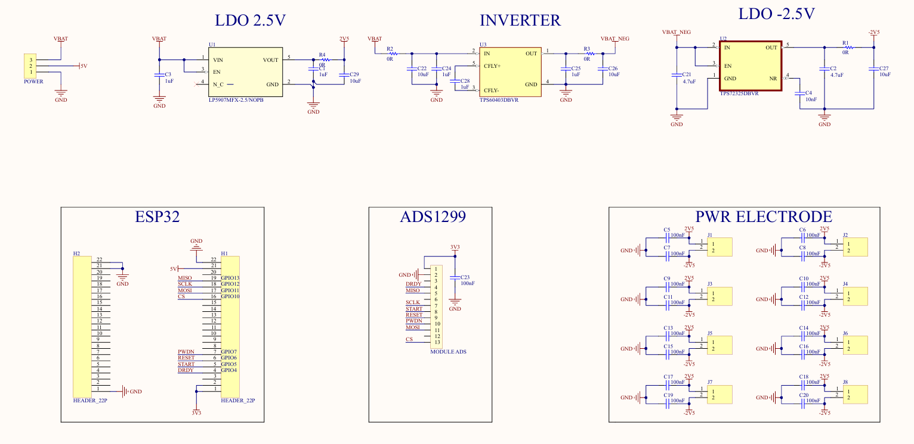

# Ảnh board ADS V2 do tác giả cung cấp

_Cập nhật GitHub ngày 26/10/2026 từ thư mục IMAGE của project V2._

## 🖼️ Top Layer

File gốc `2d_toplayer.png`, sửa lần cuối ngày 26/10/2026. Ảnh được tải nguyên bản, không cắt, đổi màu, lật hoặc dựng lại.

## 🖼️ Bottom Layer

File gốc `2d_bottomlayer.png`, sửa lần cuối ngày 26/10/2026. Đây là ảnh layout, không phải ảnh lắp ráp hay kết quả kiểm tra DRC.

## 📄 Schematic tham khảo

File gốc `Schematic.png` có thời điểm sửa ngày 19/10/2026. Ảnh này được tải kèm theo thư mục tác giả cung cấp; chưa xác nhận là schematic xuất lại từ bản PCB ngày 26/10.

## 📋 Nguồn và phiên bản

Ba file ảnh được sao chép nguyên byte từ thư mục IMAGE; kích thước, thời điểm nguồn và SHA-256 nằm trong [image-provenance.json](image-provenance.json). Nguồn Altium, BOM, pinout và Gerber không được thay thế trong lần cập nhật ảnh này.

[Giới thiệu linh kiện và cách hoạt động](../../BOARD_OVERVIEW.md) · [Các ảnh 3D tham khảo ngày 25/10](../current-2026-10-25/README.md).
